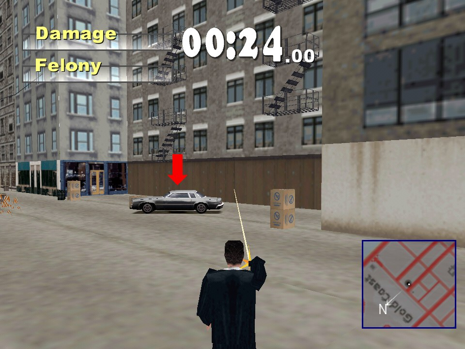
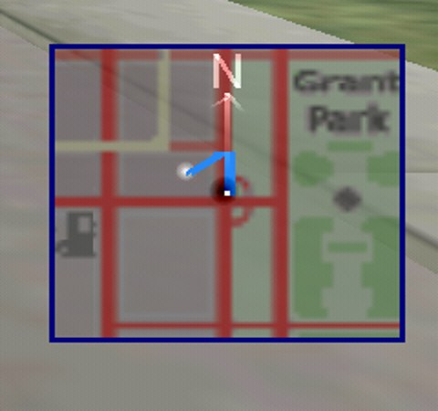
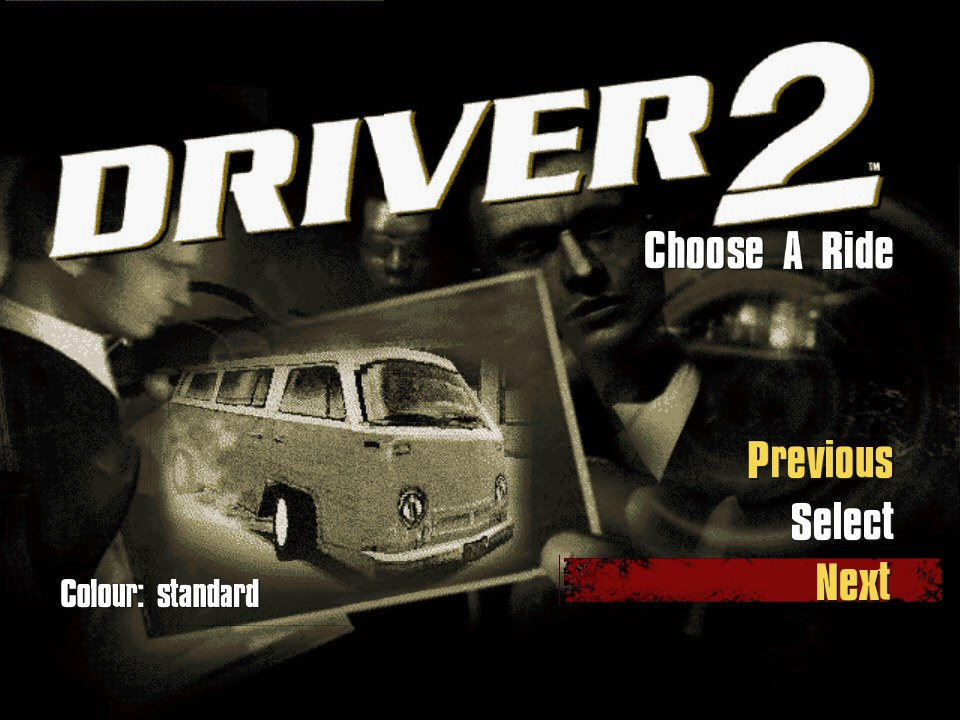

# 🚓 REDRIVER2 Mac Mods

**Driver 2 (PlayStation, 2000) running natively on Apple Silicon Macs, with a pile of extra mods: GPS navigation, a pistol, jumping out of a moving car, 60 fps, the city all the way to the horizon and more.**

   

> [!NOTE]
> **This is not a port of its own, it is a fork.** The real work is [REDRIVER2](https://github.com/OpenDriver2/REDRIVER2) by OpenDriver2, the fully reverse-engineered source of Driver 2, and the [Apple Silicon port](https://github.com/ebellumat/REDRIVER2/tree/vulkan-port) by [@ebellumat](https://github.com/ebellumat) ([PR #223](https://github.com/OpenDriver2/REDRIVER2/pull/223)). This fork adds mods the original game never had.

> [!IMPORTANT]
> **The game itself is not in this repo.** You need your own Driver 2 disc (PS1, US version; disc 1 is enough). See [Install](#-install).


## ✨ Mods

Every mod is marked `// [mod]` in the code; most live in their own files in `src_rebuild/Game/C/` (`pistol.c`, `gps_route.c`, `farcity.c`, `traffic.c`, `lamps.c`).

### 🗺️ Driving and navigation

| | |
|---|---|
| 🧭 **GPS navigation** | Set a point on the big map (Q) and follow the route along the roads on the minimap, like in GTA. In Undercover the GPS points to the mission target by itself |
| 🔍 **Secret cars on the map** | An icon where the hidden cars are parked, no cheat site needed |
| 🚦 **Speed limiter** | L keeps you just under the speed limit of the road, so the police leave you alone |
| 🏃 **Exit while driving** | Enter jumps out of a moving car, even during a chase |
| ↪️ **Sharper steering on Option** | The PlayStation's L1 (steer further and faster) is on ⌥ Option. Not on ⌘, because ⌘+Space/H/Q are macOS shortcuts |

### 🔫 On foot

| | |
|---|---|
| 🔫 **Pistol** | G draws, F fires. People dive away, the police come, cars dent and catch fire after enough hits. Also works in Undercover missions |
| 🚗 **Drive-by shooting** | F fires forward, with A/D to the left/right and with S backwards, with an arm out of the window |
| 🏃‍♂️ **Sprint** | Shift to run faster, forwards and backwards |
| 📢 **Shout** | The horn (H) makes Tanner shout "HEY!" on foot |

### 🏙️ The city

| | |
|---|---|
| 🌆 **City to the horizon** | At the end of a long street you see the real 3D buildings instead of the painted skyline |
| 🎨 **No more purple buildings** | Distant buildings whose texture is not loaded get the average colour of their real texture |
| 🚕 **Busier streets** | More cars and pedestrians |
| 💡 **Lamp posts fall over** | Lamp posts and traffic lights snap when you hit them |
| 🌑 **Shadows everywhere** | Tanner's shadow also falls on pavements and streets, and shadows work with the Z-buffer |

### 🏁 Menu and cars

| | |
|---|---|
| ▶️ **Take a Ride on top** | Enter, Enter, Enter and you are driving |
| 🌍 **All cities unlocked** | All four cities selectable right away, without finishing the story |
| 🚙 **All cars unlocked** | Including the cars that only unlock after the story, and the Havana van (sitting a bit higher on its wheels) |
| 🎨 **Pick the car colour** | Q in the car menu cycles through the colours the game has for that car |

### 🍎 Mac

| | |
|---|---|
| 🎮 **60 fps** | The game still simulates at 30 Hz like the original, but draws every screen refresh with the camera and cars interpolated in between |
| 🎵 **Music** | Music plays at the right tempo again (it nearly stopped in the 60 fps loop) |
| 🖥️ **Vsync on 60 Hz screens** | No more 20 fps on external displays |
| 📦 **Own .app** | Double-click to play without Terminal; `mac/make_app.sh` builds a standalone app |

## 📸 Screenshots

**The pistol in an Undercover mission:**



**The city up to the horizon (Rio):**


**A GPS point on the map, and Take a Ride on top:**

 

**The Havana van, with colour choice:**



## ⌨️ Controls

| Key | Does |
|---|---|
| ↑ / ↓ | Accelerate / brake and reverse |
| ← / → | Steer |
| ⌥ Option | Sharper steering (together with an arrow) |
| Space | Handbrake; on foot: get in |
| Right Shift | Burnout |
| Enter | Get out / in, also while driving |
| H | Horn; on foot Tanner shouts "HEY!" |
| A / D / S | Look left / right / back |
| C | Change camera |
| L | Speed limiter on/off |
| Shift (on foot) | Sprint |
| G / F (on foot) | Draw pistol / fire |
| F (in the car) | Fire; with A/D to the side, with S backwards |
| Esc | Pause (with "Show map") |
| Q (big map) | Set or remove the GPS point |
| Q (car menu) | Next colour |
| F3 / F6 / F7 / F12 | Smooth textures / Z-buffer / free camera / screenshot |

Keys are set in `mac/config.ini` (`[kbcontrols_game]`). Put comments there on their own line starting with `;`: text after a value becomes part of the key name.

## 📥 Install

Apple Silicon only, tested on macOS 15.

1. **Tools:** `xcode-select --install`, and with [Homebrew](https://brew.sh): `brew install premake sdl2 jpeg openal-soft`
2. **Code:**
   ```bash
   git clone --recursive https://github.com/DvT093/REDRIVER2-Mac-Mods.git src
   ```
3. **Game folder:** next to `src/`, make a `game/` folder with the game files from your disc (`DRIVER2/` and `install/Driver2CD1.bin`), see the [REDRIVER2 installation wiki](https://github.com/OpenDriver2/REDRIVER2/wiki/Installation-instructions). Put `src/mac/config.ini` in it, and `src/mac/gunshot.wav` as `game/mod/gunshot.wav`.
4. **City to the horizon (optional):** extract the level files from your disc image into `game/mod/`:
   ```bash
   cd game && for d in LEVELS NLEVELS; do python3 ../src/mac/extract_levels.py install/Driver2CD1.bin mod/DRIVER2/$d DRIVER2/$d; done
   ```
   Without them everything works, just without the distant city.
5. **Build:** copy `src/mac/build.sh` next to `src/` and run `./build.sh`. It builds the OpenGL version and puts it, signed, in `game/`.
6. **Play:** `cd game && ./REDRIVER2`, or turn `src/mac/app/` into a `Driver 2.app` next to `game/`.

All mods are in the OpenGL build. The Vulkan build still compiles, but without mods.

## 🧪 Testing

`./REDRIVER2 -nointro -nofmv -modtest [mode]` plays a short scripted bit by itself, takes screenshots and quits. Modes and environment variables are in `src_rebuild/Game/C/modtest.c` and `mac/CLAUDE.md`.

## 🙏 Credits

- [OpenDriver2 / REDRIVER2](https://github.com/OpenDriver2/REDRIVER2) (SoapyMan, Fireboyd78 and others): the reverse-engineered game and Psy-Cross. The original README is in [docs/UPSTREAM_README.md](docs/UPSTREAM_README.md)
- [@ebellumat](https://github.com/ebellumat): the macOS Apple Silicon and Vulkan port
- Driver 2 is by Reflections Interactive / Infogrames. This repo contains no game data
- The mods were made with [Claude Code](https://claude.com/claude-code)

License: MIT, like REDRIVER2.
