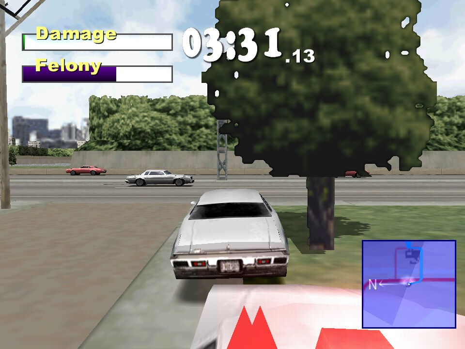
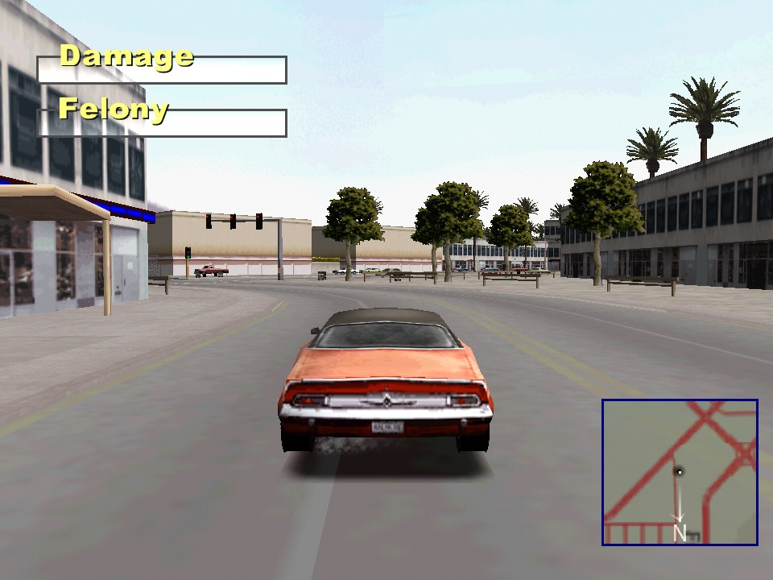
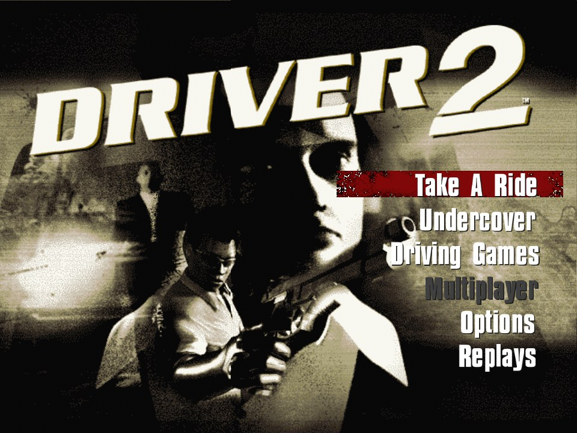

# 🚓 REDRIVER2 Mac Mods

**Driver 2 (PlayStation, 2000) native op de Mac (Apple Silicon), met een stapel eigen mods: GPS-navigatie, een pistool, uitstappen tijdens het rijden, 60 fps, de stad tot aan de horizon en meer.**

   

> [!NOTE]
> **Dit is geen eigen port, maar een fork.** Het echte werk is van [REDRIVER2](https://github.com/OpenDriver2/REDRIVER2) van OpenDriver2, de volledig terugvertaalde broncode van Driver 2, en de [Apple Silicon-versie](https://github.com/ebellumat/REDRIVER2/tree/vulkan-port) van [@ebellumat](https://github.com/ebellumat) ([PR #223](https://github.com/OpenDriver2/REDRIVER2/pull/223)). Deze fork voegt daar mods aan toe die de originele game nooit had.

> [!IMPORTANT]
> **De game zelf zit niet in deze repo.** Je hebt je eigen Driver 2-disc nodig (PS1, US-versie, disc 1 is genoeg). Zie [Installeren](#-installeren).



*English below.*

## ✨ Mods

Alle mods zijn gemarkeerd met `// [mod]` in de code, de meeste staan in eigen bestanden in `src_rebuild/Game/C/` (`pistol.c`, `gps_route.c`, `farcity.c`, `traffic.c`, `lamps.c`).

### 🗺️ Rijden en navigeren

| | |
|---|---|
| 🧭 **GPS-navigatie** | Zet op de grote kaart een punt (Q) en zie de route over de weg op de minikaart, zoals in GTA. In Undercover wijst de GPS vanzelf naar het missiedoel |
| 🔍 **Secret cars op de kaart** | Een eigen icoontje waar de verstopte auto's staan, geen cheat-site meer nodig |
| 🚦 **Speedlimiter** | Toets L houdt je net onder de snelheidslimiet van die weg, zodat de politie je laat rijden |
| 🏃 **Uitstappen tijdens het rijden** | Enter springt uit een rijdende auto, ook tijdens een achtervolging |
| ↪️ **Scherper sturen op Option** | De L1-knop van de PlayStation (verder en sneller sturen) zit op ⌥ Option. Niet op ⌘, want ⌘+Spatie/H/Q zijn macOS-sneltoetsen |

### 🔫 Te voet

| | |
|---|---|
| 🔫 **Pistool** | G trekt, F schiet. Mensen duiken weg, de politie komt, auto's krijgen deuken en vliegen na genoeg treffers in brand. Werkt ook in Undercover-missies |
| 🚗 **Schieten uit de auto** | F schiet vooruit, met A/D naar links/rechts en met S naar achteren, met een arm uit het raam |
| 🏃‍♂️ **Sprinten** | Shift om harder te rennen, vooruit en achteruit |
| 📢 **Roepen** | De toeter (H) laat Tanner te voet "HEY!" roepen |

### 🏙️ De stad

| | |
|---|---|
| 🌆 **Stad tot aan de horizon** | Aan het eind van een lange straat zie je de echte 3D-gebouwen in plaats van de geschilderde skyline |
| 🎨 **Geen paarse huizen meer** | Verre gebouwen zonder geladen textuur krijgen de gemiddelde kleur van hun echte textuur |
| 🚕 **Drukker verkeer** | Meer auto's en voetgangers op straat |
| 💡 **Lantaarnpalen vallen om** | Lantaarnpalen en stoplichten knakken als je ze raakt |
| 🌑 **Schaduwen overal** | Tanners schaduw valt ook op stoep en straat, en schaduwen werken samen met de Z-buffer |

### 🏁 Menu en auto's

| | |
|---|---|
| ▶️ **Take a Ride bovenaan** | Enter, Enter, Enter en je rijdt |
| 🌍 **Alle steden vrij** | Alle vier de steden meteen kiesbaar, zonder het verhaal uit te spelen |
| 🚙 **Alle auto's vrij** | Ook de auto's die pas na het verhaal vrijkomen, en het busje in Havana (iets hoger op zijn wielen) |
| 🎨 **Autokleur kiezen** | Q in het automenu wisselt tussen de kleuren die de game voor die auto heeft |

### 🍎 Mac

| | |
|---|---|
| 🎮 **60 fps** | De game rekent op 30 Hz zoals het origineel, maar tekent elk scherm-frame met vloeiende camera en auto's ertussen |
| 🎵 **Muziek** | De muziek speelt weer op tempo (stond in de 60 fps-loop bijna stil) |
| 🖥️ **Vsync op 60 Hz-schermen** | Geen 20 fps meer op externe schermen |
| 📦 **Eigen .app** | Dubbelklikken zonder Terminal, en `mac/make_app.sh` maakt een losse app om te delen |

## 📸 Screenshots

**Pistool in een Undercover-missie:**


**De stad tot aan de horizon (Rio):**



**GPS-punt op de kaart en Take a Ride bovenaan:**

 

**Het busje in Havana, met kleurkeuze:**


## ⌨️ Toetsen

| Toets | Doet |
|---|---|
| ↑ / ↓ | Gas / remmen en achteruit |
| ← / → | Sturen |
| ⌥ Option | Scherper sturen (met een pijltje erbij) |
| Spatie | Handrem; te voet: instappen |
| Rechter Shift | Burnout |
| Enter | Uitstappen / instappen, ook tijdens het rijden |
| H | Toeter; te voet roept Tanner "HEY!" |
| A / D / S | Kijk links / rechts / achter |
| C | Andere camera |
| L | Speedlimiter aan/uit |
| Shift (te voet) | Sprinten |
| G / F (te voet) | Pistool trekken / schieten |
| F (in de auto) | Schieten; met A/D opzij, met S naar achteren |
| Esc | Pauze (met "Show map") |
| Q (grote kaart) | GPS-punt zetten of weghalen |
| Q (automenu) | Andere kleur |
| F3 / F6 / F7 / F12 | Gladde textures / Z-buffer / vrije camera / screenshot |

De toetsen staan in `mac/config.ini` (`[kbcontrols_game]`). Zet commentaar daar op een eigen regel die met `;` begint: tekst achter een waarde wordt deel van de toetsnaam.

## 📥 Installeren

Alleen Apple Silicon, getest op macOS 15.

1. **Gereedschap:** `xcode-select --install`, en met [Homebrew](https://brew.sh): `brew install premake sdl2 jpeg openal-soft`
2. **Code:**
   ```bash
   git clone --recursive https://github.com/DvT093/REDRIVER2-Mac-Mods.git src
   ```
3. **Speelmap:** maak naast `src/` een map `game/` met de spelbestanden van je disc (`DRIVER2/` en `install/Driver2CD1.bin`), zie de [installatiewiki van REDRIVER2](https://github.com/OpenDriver2/REDRIVER2/wiki/Installation-instructions). Zet daarin `src/mac/config.ini` en `src/mac/gunshot.wav` (als `game/mod/gunshot.wav`).
4. **Stad tot de horizon (optioneel):** `python3 src/mac/extract_levels.py` haalt de levelbestanden uit je disc-image naar `game/mod/`. Zonder die bestanden werkt alles, alleen zonder de verre stad.
5. **Bouwen:** kopieer `src/mac/build.sh` naast `src/` en draai `./build.sh`. Dat bouwt de OpenGL-versie en zet hem ondertekend in `game/`.
6. **Spelen:** `cd game && ./REDRIVER2`, of zet `src/mac/app/` om tot `Driver 2.app` naast `game/`.

Alle mods zitten in de OpenGL-versie. De Vulkan-versie bouwt nog wel, maar zonder mods.

## 🧪 Testen

`./REDRIVER2 -nointro -nofmv -modtest [modus]` speelt zelf een stukje, maakt screenshots en sluit af. Modi en omgevingsvariabelen staan in `src_rebuild/Game/C/modtest.c` en `mac/CLAUDE.md`.

## 🙏 Credits

- [OpenDriver2 / REDRIVER2](https://github.com/OpenDriver2/REDRIVER2) (SoapyMan, Fireboyd78 en anderen): de terugvertaalde game en Psy-Cross. De originele README staat in [docs/UPSTREAM_README.md](docs/UPSTREAM_README.md)
- [@ebellumat](https://github.com/ebellumat): de macOS Apple Silicon- en Vulkan-port
- Driver 2 is van Reflections Interactive / Infogrames. Deze repo bevat geen spelbestanden
- De mods zijn gemaakt met [Claude Code](https://claude.com/claude-code)

---

## 🇬🇧 English

**Driver 2 (PS1, 2000) running natively on Apple Silicon Macs, with a pile of extra mods.** This is a fork of [REDRIVER2](https://github.com/OpenDriver2/REDRIVER2) (the fully reverse-engineered Driver 2 source) on top of [@ebellumat's Apple Silicon port](https://github.com/ebellumat/REDRIVER2/tree/vulkan-port). Bring your own Driver 2 disc (US, disc 1); no game data is included.

**Mods:** GPS navigation on the minimap (set a point on the big map with Q; automatic in Undercover missions), secret cars on the map, speed limiter (L), jump out of a moving car (Enter), sharper steering on ⌥ Option (PS1 L1), a pistol on foot (G/F) with fleeing people, police, dents and fires, drive-by shooting (F, with A/D/S for left/right/back), sprinting (Shift), shouting (H on foot), the real city up to the horizon instead of the painted skyline, no more purple distant buildings, busier traffic, lamp posts that fall over, shadows on every surface and with the Z-buffer, Take a Ride at the top of the menu, all cities and all cars unlocked, car colour choice (Q), 60 fps with interpolation, fixed music tempo and vsync on 60 Hz screens.

**Install:** see the Dutch steps above: `brew install premake sdl2 jpeg openal-soft`, `git clone --recursive`, put your disc data in `game/` per the [REDRIVER2 wiki](https://github.com/OpenDriver2/REDRIVER2/wiki/Installation-instructions), then run `mac/build.sh`. All mods are in the OpenGL build.

License: MIT, like REDRIVER2.
